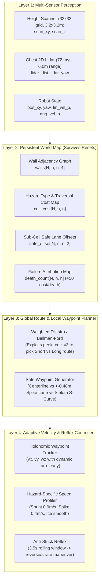

# Challenge 7.5 — G1 Hazard Maze: Complete Methods Guide & Implementation Plan

This document provides a complete technical analysis, catalog of methods (both **Locomotion Policy Training** and **Autopilot Navigation Algorithms**), and a step-by-step **Implementation Plan** for **Challenge 7.5 (G1 Hazard Maze)** using the [`g1_hazard_lab`](./README.md) and [`simulation-for-humanoid/Week07_Curriculum_Maze/g1_maze_lab`](../simulation-for-humanoid/Week07_Curriculum_Maze/g1_maze_lab/README.md) workspaces.

---

## 1. Workspace & Challenge Overview

### 1.1 Relationship Between the Two Folders
| Workspace Folder | Current State & Contents |
| :--- | :--- |
| `simulation-for-humanoid/Week07_Curriculum_Maze/g1_maze_lab` | Original Week 7 lab workspace containing your training logs: `logs/rsl_rl/g1_curriculum/...` (`push300`) and `logs/rsl_rl/g1_hazard_starter/2026-10-31_10-42-27/model_5600.pt` (600 fine-tuning iterations on `G1-Hazard-Starter`). |
| `g1_hazard_lab` | Dedicated Challenge 7.5 workspace containing the top-level [`pilot.py`](./pilot.py) template and updated [`scripts/challenge.py`](./scripts/challenge.py) that automatically loads `./pilot.py` when testing locally. |

### 1.2 Challenge Levels & Scoring Rules ([`scripts/challenge.py`](./scripts/challenge.py))
| Level | Task Name | Grid Size | Start / Goal Cells | Time Limit | Key Hazards |
| :--- | :--- | :---: | :---: | :---: | :--- |
| **`7`** (Practice) | `G1-Maze-Hard` | `7 × 7` (`14 × 14 m`) | `(0, 0)` $\rightarrow$ `(6, 6)` (or `--random-ends`) | `300 s` | Short route: `1` gap, `2` steep ramps, `2` spikes, rough fill, `1` ice. Long route: `2` low ramps, `1` spike, `3` rough, `2` ice. |
| **`9`** (Practice) | `G1-Maze-Hard9` | `9 × 9` (`18 × 18 m`) | `(0, 0)` $\rightarrow$ `(8, 8)` (or `--random-ends`) | `480 s` | Short route: `2` gaps, `2` steep ramps, `2` spikes, **`1` slalom spike**, rough fill. Long route: `3` low ramps, **`2` spikes**, `4` rough, `3` ice. |
| **`final`** (Competition) | `G1-Maze-Final` | `10 × 10` (`20 × 20 m`) | Random from seed (Manhattan dist $\ge 10$) | `600 s` | Same hazard types as Level 9 on a `10 × 10` grid with randomized start and goal cells. |

* **Winning Condition (`GOAL`)**: Reach within `0.6 m` of the `goal_cell` center. Ranked by **fastest finish time (`time_s`)**, tie-broken by fewer falls.
* **Tie-Breaker (`DNF`)**: If time expires, ranked by **closest remaining route distance (`best_left_m`)** to the goal along the route taken, then fewer falls.
* **Reset-to-Start Penalties (Clock Keeps Running!)**:
  1. **Fall (`base_contact`)**: `torso_link` contacts the ground/obstacle (`> 1.0 N`).
  2. **Wall / Body Crash (`body_contact`)**: `torso_link`, `pelvis`, `.*_elbow_.*`, or `.*_palm_link` touches a wall (`> 1.0 N`).
  3. **Deadly Spike Bed (`spike_hit`)**: **Any body link** of the robot enters a spike bed bounding box `(x0, y0, x1, y1)` at height `z < spike_top + 0.02` (`0.37 m`).
  4. **Stuck Timer (`STUCK_TIME = 10.0 s`)**: Moving less than `0.25 m` over a 10-second check interval resets the robot to `start_cell`.

### 1.3 Hard Submission Constraints ([`scripts/challenge_server.py`](./scripts/challenge_server.py))
1. **Policy Network Lock (`check_policy`)**:
   * `policy.pt` **must have the exact same `actor_state_dict` layer shapes** as `pretrained/g1_rough/model_pretrained.pt`.
   * You **cannot** alter the policy's observation vector or its internal `height_scanner` (`1.6 m × 1.0 m`, `0.1 m` resolution).
2. **Pilot Map-Reading Ban (`check_python`)**:
   * `pilot.py` (and up to 5 helper `.py` files) must compile cleanly, define `class Pilot`, and **must not** reference `GENERATED`, `HAZARDS`, `HARD_CELLS`, or import `g1_maze_lab.terrains`.

---

## 2. Maze Topology & Hazard Geometry Reference

From [`src/g1_maze_lab/terrains/hazard_maze.py`](./src/g1_maze_lab/terrains/hazard_maze.py), every cell is `cell_size = 2.0 m` with `wall_thickness = 0.15 m` (inner corridor width = `1.85 m`, half-width `hw = 0.925 m`).
At `start_cell`, an extra wall is opened (`start_fork = True`), creating **two routes**:
* **SHORT Route**: At least `6` cells shorter (`min_route_gap = 6`) and at least `2` fewer turns (`min_extra_turns = 2`), but contains all **trenches**, **steep ramps**, and **slaloms**. The first hard hazard (`ramp` or `spike`) is guaranteed within the first `peek_cells = 3` cells after the fork.
* **LONG Route**: Longer and twistier, but has **no trenches**, **no slaloms**, and **only low ramps**, **single-lane spikes**, **ice**, and **rough boxes**.

| Hazard Type | Placement | Exact Geometry (`2.0 m × 2.0 m` cell) | Physics / Friction | Height Scanner Signature (`scan_z`) |
| :--- | :--- | :--- | :---: | :--- |
| **Maze Wall** | Cell borders | `0.15 m` thick, `1.0 m` tall (`z in [0, 1.0] m`) | `mu = 1.0` | `scan_z > 0.50 m` along cell edges (`±1.0 m` from center) |
| **Trench (`gap`)** | Straight cell (Short route only) | Full-width cut across corridor; width `0.15–0.22 m`, depth `1.0 m` | `mu = 1.0` | Strip of rays with `scan_z < -0.15 m` (`z ≈ -1.0 m`) across corridor center |
| **Steep Ramp (`short_ramp`)** | Straight cell (Short route only) | Trapezoid prism across full corridor width: `0.75 m` slope up, `0.50 m` flat top, `0.75 m` slope down; height `0.24–0.30 m` (`18°–22°`) | `mu = 1.0` | Smooth elevation across **both** left & right corridor halves with `max(scan_z) in [0.22, 0.31] m` |
| **Low Ramp (`long_ramp`)** | Straight cell (Long route only) | Same trapezoid prism (`0.75 m` slopes, `0.50 m` top); height `0.10–0.18 m` (`7.5°–13.5°`) | `mu = 1.0` | Smooth elevation across **both** left & right corridor halves with `max(scan_z) in [0.10, 0.19] m` |
| **Single-Lane Spike (`lane`)** | Straight cell (Both routes) | Bed of cones (`h = 0.25–0.35 m`, `pitch = 0.15 m`), length `1.4 m` along corridor, spanning from one wall (`±0.925 m`) to `[-0.10, 0.0] m` near center | `mu = 0.3` (**Deadly** in `challenge.py`) | **Asymmetric**: Cones (`0.15 < scan_z < 0.36 m`) on **one lateral side** only; opposite side (`0.93–1.03 m` wide) is flat (`|scan_z| < 0.03 m`) |
| **Slalom Spike (`slalom`)** | Straight cell (Short route L9/Final) | Two opposite-side beds (`total length = 1.8 m`) separated by a `0.6 m` longitudinal gap (`u in [-0.3, +0.3] m`) | `mu = 0.3` (**Deadly** in `challenge.py`) | Entry half (`u < -0.3 m`) has spikes on side $s_1$; exit half (`u > +0.3 m`) has spikes on opposite side $-s_1$ |
| **Rough Floor (`rough`)** | Any non-banned cell | `10` random boxes (`0.15–0.40 m` wide, `0.02–0.08 m` high) | `mu = 1.0` | Scattered local bumps with `0.02 < scan_z < 0.09 m` and `max(scan_z) < 0.10 m` |
| **Ice Tile (`ice`)** | Any non-banned cell | `1.85 m × 1.85 m` slab raised `1 cm` (`z = +0.01 m`) | `mu = 0.2` (slippery, `mjc:priority = 1`) | Uniform flat plateau at `scan_z ≈ 0.01 m` + high velocity slip `||lin_vel_b - cmd||` |

---

## 3. Part 1: Locomotion Policy (`policy.pt`) Methods

### 3.1 Do We Need to Train a New Model with Custom Cell Generation & Speed Optimization?

* **If your goal is a reliable finish via the Long Route:**
  * You **do not strictly need** a custom terrain generator. A well-engineered `pilot.py` paired with `pretrained/g1_rough/model_pretrained.pt` or your `G1-Hazard-Starter` checkpoint (`model_5600.pt`) can take the **Long Route** (which only has `0.10–0.18 m` low ramps, `2–8 cm` boxes, ice, and single-lane spikes that the pilot steers around).
* **If your goal is the fastest leaderboard time (taking the Short Route OR sprinting at `0.9–1.4 m/s`):**
  * **Yes — training a new model with custom cell/corridor generation and a velocity/gait curriculum is essential.**
  * **Why `G1 Rough` fails on the Short Route**:
    1. `G1 Rough` was never trained on **trenches (`gaps`)**; its foot drops into the `0.15–0.22 m` slot and gets wedged (`STUCK` $\rightarrow$ reset) or trips (`base_contact` $\rightarrow$ reset).
    2. `G1 Rough` gets stuck on **steep ramps (`0.24–0.30 m`)** because the `22°` trapezoid prism transition is sharper than its training pyramid slopes.
    3. `G1 Rough` was trained with **`lin_vel_y = (0.0, 0.0)`** and **`heading_command = True`**! It was never trained to sidestep (`v_y != 0`) around spike beds or walk backward (`v_x < 0`) to unstick itself.

### 3.2 Comparison of All Policy Training Methods

| Method | Training Setup | Strengths | Weaknesses |
| :--- | :--- | :--- | :--- |
| **Method P1: Pretrained `g1_rough` (Zero-Shot)** | `pretrained/g1_rough/model_pretrained.pt` | Zero training required; rock-solid gait on flat/rough ground and low ramps (`< 0.18 m`). | Cannot cross trenches or `> 0.24 m` ramps; no lateral `v_y` tracking; slips on `mu = 0.2` ice at high yaw rates. |
| **Method P2: `G1-Hazard-Starter` Fine-Tuning** | [`G1HazardStarterEnvCfg`](./src/g1_maze_lab/tasks/hazard_starter/env_cfg.py): Isaac Lab built-in `MeshGapTerrainCfg`, `HfPyramidSlopedTerrainCfg`, `MeshRandomGridTerrainCfg`, foot friction `0.2–1.0`, `lin_vel_x = (0.0, 0.8)`. | Already implemented; your `model_5600.pt` checkpoint has 600 iterations on this task. Learns ice balance and basic gap stepping. | Built-in `MeshGapTerrainCfg` only places a single square trench around the spawn platform (robots rarely cross it). Pyramid slopes lack the trapezoid flat-top transition of maze ramps. Speed capped at `0.8 m/s`; `lin_vel_y` is still `(0.0, 0.0)`. |
| **Method P3: Custom Hazard-Corridor Generator (`G1-Hazard-Pro`)** | Custom trimesh sub-terrain generating `2 m`-wide lanes with **repeated parallel trenches (`0.08–0.25 m`)**, **exact trapezoid ramps (`0.10–0.32 m`)**, and **rough boxes (`0.02–0.08 m`)** scaled by curriculum difficulty. | Matches the exact geometry of `hazard_maze.py`. High encounter frequency (robot crosses a trench or ramp every `2–3 m`). | Takes ~25–35 minutes (1000–1500 iterations) to fine-tune from `g1_rough` or `model_5600.pt`. |
| **Method P4: Speed, Gait & Omnidirectional Curriculum** | Combine Method P2/P3 with direct velocity commands (`heading_command = False`), lateral/reverse velocity ranges, `RewardWeightRampCurriculum` on `feet_air_time`, and `CommandRangeCurriculum` on `lin_vel_x`. | Unlocks **fast sprinting (`1.0–1.4 m/s`)** on straightaways, **lateral sidestepping (`v_y` in `[-0.35, 0.35]`)** for dodging spikes without turning, **backward recovery (`v_x < 0`)**, and high foot clearance over trenches. | Must keep `CommandRangeCurriculum` threshold (`>= 0.8`) so speed only increases after the robot masters rough/gap terrain. |

### 3.3 Detailed Design of the Custom Training Environment (Methods P3 + P4)

To train the strongest possible `policy.pt` without violating `check_policy`:

1. **Custom Corridor Sub-Terrain (`hazard_track_terrain`)**:
   * Create an `8.0 m × 8.0 m` sub-terrain consisting of four `2.0 m`-wide parallel corridors separated by low guide walls or open lanes.
   * Along each `8.0 m` corridor, place 3 sequential `2.0 m` hazard cells scaled by `difficulty` $\in [0, 1]$:
     * **Trench Track**: 3 trenches per lane with widths $w = 0.06 + 0.18 \times \text{difficulty}$ (`0.06 m` $\rightarrow$ `0.24 m`), depth `1.0 m`.
     * **Trapezoid Ramp Track**: 2 trapezoid prisms per lane using the exact `hazard_maze.py` profile (`ramp_length = 0.75 m`, flat top `0.50 m`, height $h = 0.08 + 0.24 \times \text{difficulty}$ from `0.08 m` $\rightarrow$ `0.32 m`).
     * **Rough + Step Track**: `10` random boxes per `2 m × 2 m` section (`height = 0.02` to `0.03 + 0.06 * difficulty`) plus `1 cm` ice-like step edges.
2. **Command Configuration for Speed & Agility**:
   * Set `self.commands.base_velocity.heading_command = False` (or `rel_heading_envs = 0.2`) so the policy trains directly on `(v_x, v_y, w_z)` commands just like `pilot.act(obs)` sends.
   * Set command ranges:
     * `lin_vel_x = (-0.25, 0.9)` initially, ramped up to `(-0.25, 1.4)` via `CommandRangeCurriculum`.
     * `lin_vel_y = (-0.35, 0.35)` so the pilot can command pure lateral strafing around spike beds.
     * `ang_vel_z = (-1.2, 1.2)` for responsive cornering.
3. **Reward & Curriculum Terms**:
   * **`feet_air_time` Ramp (`RewardWeightRampCurriculum`)**: Ramp `rewards.feet_air_time.weight` from `0.25` $\rightarrow$ `0.85` over 300 iterations so the robot learns a high-stepping gait that clears `0.22 m` trenches and `0.08 m` boxes.
   * **`AdaptivePushCurriculum`**: Ramp external velocity pushes from `0.0` $\rightarrow$ `0.8 m/s` (when fall rate `< 5%`) to make the policy resilient against slipping on `mu = 0.2` ice tiles.
   * **`physics_blowup` Termination**: Retain `physics_blowup` from `G1HazardStarterEnvCfg` so NaN states on trench edges reset cleanly without crashing training.

---

## 4. Part 2: Autopilot (`pilot.py`) Algorithms

### 4.1 Why the Baseline `DefaultPilot` (`MazeAutopilot`) Fails
1. **Centerline Walking**: `MazeAutopilot` always drives toward the exact cell center `(2i, 2j)`. Because spike beds extend from the wall to `[-0.10, 0.0] m` from the centerline and the robot is `~0.35 m` wide, walking down the centerline **always hits the spike cones**.
2. **Unweighted Flood-Fill**: Every open cell has cost `1`, so it **always chooses the Short Route**, marching straight into trenches, `0.30 m` steep ramps, and slalom spikes.
3. **Memory Wipe on Reset**: `MazeAutopilot.reset()` sets `self.walls[:] = -1` on every fall/reset, forgetting both the maze layout and the hazard that just killed the robot.
4. **No Anti-Stuck or Speed Adaptation**: Uses a constant `speed = 0.6 m/s` everywhere and has no recovery maneuver if a foot catches on a ramp or wall.

### 4.2 Four-Layer Pilot Architecture



---

### 4.3 Layer 1: Hazard Perception & Classification Algorithms

For any cell `(i, j)` whose center `(cx, cy) = (2i, 2j)` falls within the `3.2 m × 3.2 m` height-scanner window (i.e. current cell and immediate neighbor cells):
Let `(dx, dy) = (scan_xy[..., 0] - cx, scan_xy[..., 1] - cy)`.
In a corridor aligned with axis $a \in \{0, 1\}$ (where $a=0$ is along $x$ and $a=1$ is along $y$), define:
* **Longitudinal coordinate** $u = dx$ (if $a=0$) else $dy$, within $u \in [-0.90, +0.90]\text{ m}$.
* **Lateral coordinate** $v = dy$ (if $a=0$) else $dx$, within $v \in [-0.85, +0.85]\text{ m}$ (avoiding the walls at $\pm 0.925\text{ m}$).

#### Classification Rules (Evaluated Every Step):
1. **Wall Detection (Height Scan + Lidar Lookahead)**:
   * **Near walls**: `walls_from_height_scan` (`scan_z > 0.50 m` in `0.3 m × 1.2 m` edge boxes).
   * **Corridor lookahead (optional boost)**: Use `lidar_dist` and `lidar_yaw` along cardinal directions ($\theta \in \{0, \pi/2, \pi, -\pi/2\}$ within $\pm 5^\circ$) to mark open/closed cell boundaries up to `2` cells ahead (`4.0 m`) when walking down a straight corridor.
2. **Trench / Gap (`TRENCH`)**:
   * If `count(scan_z < -0.15 m)` inside `|u| < 0.80, |v| < 0.75` is $\ge 3$: classify cell as **`TRENCH`**.
3. **Ramp vs. Spike Bed Disambiguation (`STEep_RAMP`, `LOW_RAMP`, `SPIKE_LANE`, `SPIKE_SLALOM`)**:
   * Filter elevated obstacle hits (excluding walls): `elev = (scan_z > 0.11) & (scan_z < 0.42)`.
   * Split the corridor width into **Left/Positive side** ($v \in [0.12, 0.82]\text{ m}$) and **Right/Negative side** ($v \in [-0.82, -0.12]\text{ m}$):
     * **Case A — Both sides elevated (`count_pos >= 4` and `count_neg >= 4` in the same longitudinal half)**:
       * Check if it is a **Slalom** vs. a **Ramp**:
         * Divide longitudinally into **Half 1** ($u \in [-0.85, -0.15]$) and **Half 2** ($u \in [+0.15, +0.85]$).
         * In a **Ramp**, within *both* Half 1 and Half 2, the elevation is symmetric across $v > 0$ and $v < 0$ ($\max z_{pos} \approx \max z_{neg}$).
           * If $\max(\text{scan\_z}) > 0.21\text{ m}$ $\rightarrow$ **`STEEP_RAMP`** (`0.24–0.30 m`, Short Route).
           * If $0.11 < \max(\text{scan\_z}) \le 0.21\text{ m}$ $\rightarrow$ **`LOW_RAMP`** (`0.10–0.18 m`, Long Route).
         * In a **Slalom Spike (`SPIKE_SLALOM`)**, Half 1 is only elevated on side $s_1 \in \{-1, +1\}$ while $-s_1$ is flat (`|z| < 0.04 m`), AND Half 2 is only elevated on the opposite side $-s_1$ while $s_1$ is flat! Record safe offsets: Half 1 safe offset $= -s_1 \times 0.48\text{ m}$, Half 2 safe offset $= +s_1 \times 0.48\text{ m}$.
     * **Case B — Only one lateral side elevated (`count_pos >= 3` XOR `count_neg >= 3`)**:
       * Classify as **`SPIKE_LANE`**.
       * If spikes are on $v > 0$ (`count_pos > count_neg`), the safe lane is on the negative side: $v_{\text{safe}} = -0.48\text{ m}$.
       * If spikes are on $v < 0$ (`count_neg > count_pos`), the safe lane is on the positive side: $v_{\text{safe}} = +0.48\text{ m}$.
4. **Rough Floor (`ROUGH`) & Ice (`ICE`)**:
   * If not any of the above and `count(0.025 < scan_z < 0.095) >= 4` $\rightarrow$ **`ROUGH`**.
   * If flat with median `scan_z` $\in [0.006, 0.015]\text{ m}$ $\rightarrow$ **`ICE`**.

---

### 4.4 Layer 2: Persistent Memory & Failure Attribution Across Resets

When the robot falls, touches a spike, or gets stuck, `challenge.py` resets the robot to `start_cell` and calls `pilot.reset(env_ids)` while the timer keeps running.
1. **Preserve Map Knowledge**:
   * Do **not** reset `self.ap.walls`, `self.cell_type`, `self.cell_cost`, or `self.safe_offset` inside `pilot.reset(env_ids)`.
2. **Penalize the Failure Cell**:
   * Track `self.prev_cell` and `self.target` during `act(obs)`.
   * On `reset(env_ids)`, increment `self.deaths[env_ids, fail_i, fail_j] += 1` (for both the cell the robot was in and the target cell if it was crossing an edge).
   * Add `50.0 * self.deaths[env_ids, i, j]` to the cell's planning cost.
   * **Effect**: If the robot attempts the Short Route and falls in a trench or hits a slalom spike, on respawn that cell's cost jumps by `+50.0`, and **Weighted Dijkstra immediately routes the robot onto the Long Route**!

---

### 4.5 Layer 3: Global Route Planning Algorithms

Replace `MazeAutopilot.flood_fill` with **Hazard-Weighted Bellman-Ford / Dijkstra**:

```python
def weighted_flood_fill(self, walls: torch.Tensor, cell_costs: torch.Tensor) -> torch.Tensor:
    """Compute minimum cumulative cost-to-goal from every cell (N, n, n)."""
    n = self.n
    big = 1e6
    dist = torch.full((self.num_envs, n, n), big, dtype=torch.float32, device=self.device)
    dist[:, self.goal[0], self.goal[1]] = 0.0
    blocked = walls == 1  # -1 (unknown) and 0 (open) are both traversable
    for _ in range(n * n):
        new = dist.clone()
        # Step cost into neighbor (ni, nj) is cell_costs[:, ni, nj]
        new[:, :-1, :] = torch.minimum(new[:, :-1, :], torch.where(blocked[:, :-1, :, 0], big, dist[:, 1:, :] + cell_costs[:, 1:, :]))
        new[:, 1:, :]  = torch.minimum(new[:, 1:, :],  torch.where(blocked[:, 1:, :, 2],  big, dist[:, :-1, :] + cell_costs[:, :-1, :]))
        new[:, :, :-1] = torch.minimum(new[:, :, :-1], torch.where(blocked[:, :, :-1, 1], big, dist[:, :, 1:] + cell_costs[:, :, 1:]))
        new[:, :, 1:]  = torch.minimum(new[:, :, 1:],  torch.where(blocked[:, :, 1:, 3],  big, dist[:, :, :-1] + cell_costs[:, :, :-1]))
        if torch.allclose(new, dist):
            break
        dist = new
    return dist
```

#### Two Strategy Profiles for Cell Costs (`cell_costs`):
1. **Profile A — Safe / Long-Route Pivot (Best for `g1_rough` or `G1-Hazard-Starter` `model_5600.pt`)**:
   * `PLAIN = 1.0`, `UNKNOWN = 1.05`, `ICE = 1.2`, `ROUGH = 1.3`, `LOW_RAMP = 1.5`, `SPIKE_LANE = 1.8`
   * `SPIKE_SLALOM = 15.0`, `TRENCH = 20.0`, `STEEP_RAMP = 25.0`, `DEATH = +50.0`
   * *Behavior*: Robot peeks 1–2 cells into the Short Route (`peek_cells = 3`), detects the first `STEEP_RAMP`, `TRENCH`, or `ROUGH` fill, sees the cumulative Short Route cost exceed the Long Route cost, and immediately pivots to the Long Route with zero falls!
2. **Profile B — Aggressive Short-Route Sprinter (Best for Custom `G1-Hazard-Pro` Policy)**:
   * `PLAIN = 1.0`, `UNKNOWN = 1.05`, `ICE = 1.2`, `ROUGH = 1.2`, `LOW_RAMP = 1.3`, `SPIKE_LANE = 1.5`
   * `TRENCH = 2.5`, `STEEP_RAMP = 3.0`, `SPIKE_SLALOM = 3.5`, `DEATH = +50.0`
   * *Behavior*: Takes the Short Route first to win on time; if it suffers a fall on an unexpectedly hard obstacle, `+50.0` death penalty automatically switches it to the Long Route on the second try.

---

### 4.6 Layer 4: Local Trajectory, Spike Dodging & Velocity Control Algorithms

1. **Sub-Cell Waypoint Generation (Safe Lane & Slalom S-Curve)**:
   * When walking through a **`SPIKE_LANE`** cell `(i, j)` along corridor axis $a$, shift the target waypoint perpendicular to the corridor by $v_{\text{safe}} = \pm 0.48\text{ m}$.
   * Also apply a **pre-alignment shift**: as soon as the robot is in the cell *before* a spike cell and heading into it, shift the exit waypoint of the current cell by $v_{\text{safe}} = \pm 0.45\text{ m}$ so the robot is **already in the safe lane before crossing the cell boundary**!
   * When walking through a **`SPIKE_SLALOM`** cell `(i, j)`:
     * Subdivide the cell into 3 sequential waypoints along longitudinal coordinate $u \in [-1.0, +1.0]\text{ m}$ (oriented along travel direction):
       1. **Waypoint 1 (Entry Lane)**: $u_1 = -0.55\text{ m}$, $v_1 = v_{\text{safe, entry}} = \pm 0.48\text{ m}$ (advance when within `0.25 m`).
       2. **Waypoint 2 (Center Gap Crossover)**: $u_2 = 0.00\text{ m}$, $v_2 = -v_{\text{safe, entry}} \times 0.25\text{ m}$ (cross through the `0.6 m` gap between the two beds).
       3. **Waypoint 3 (Exit Lane)**: $u_3 = +0.60\text{ m}$, $v_3 = v_{\text{safe, exit}} = \mp 0.48\text{ m}$.
2. **Local Point-Cloud Spike Repulsion (Safety Shield)**:
   * Transform nearby spike-height points (`0.14 < scan_z < 0.38 m` that are not walls or symmetric ramps) into the robot's body frame `(x_b, y_b)`.
   * If any point lies in the front danger zone (`x_b in [-0.15, +0.75] m`, `|y_b| < 0.42 m`):
     * Add an immediate repulsive lateral offset or yaw bias away from `sign(y_b)` and cap forward speed to `0.30 m/s` until clear.
3. **Context-Adaptive Velocity & Dynamic `turn_early`**:
   * **Dynamic `turn_early`**:
     * Normal open cells: `turn_early = 0.55 m` (smooth arc turns).
     * Current or next cell is `SPIKE_LANE`, `SPIKE_SLALOM`, or `TRENCH`: `turn_early = 0.20 m` (never cut corners early into a spike bed!).
   * **Adaptive Speed Profile (`v_x`)**:
     * Clear straight corridor (`PLAIN`, `|yaw_err| < 0.2 rad`): `v_x = 0.85 m/s` (`1.1 m/s` with custom policy).
     * `ROUGH` / `LOW_RAMP`: `v_x = 0.65 m/s`.
     * `TRENCH` / `STEEP_RAMP`: Align heading first (`|yaw_err| < 0.12 rad`), then cross straight at `v_x = 0.70 m/s`.
     * `SPIKE_LANE` / `SPIKE_SLALOM`: `v_x = 0.40 m/s` for high-precision path tracking.
     * `ICE`: `v_x = 0.50 m/s`, cap `|w_z| <= 0.6 rad/s` and `max_acc = 0.5 m/s²`.
4. **Anti-Stuck Reflex (Beating the `10.0 s` Stuck Timer)**:
   * Record `pos_xy` every `0.5 s` in a circular buffer of length `7` (`3.5 s` history).
   * If `||pos_xy - pos_history[0]|| < 0.20 m` after `3.5 s`:
     * Enter **Unstuck Mode** for `1.2 s`: command `v_x = -0.30 m/s`, `v_y = ±0.20 m/s`, `w_z = ±0.8 rad/s` (back up and turn away from the obstacle), and increment the obstacle cell's cost by `+15.0` to trigger replanning.

---

## 5. Step-by-Step Implementation Plan

### Step 1: Bring Over Your Trained Checkpoint & Run Baseline Tests
1. Copy `model_5600.pt` from `simulation-for-humanoid/Week07_Curriculum_Maze/g1_maze_lab/logs/rsl_rl/g1_hazard_starter/2026-10-31_10-42-27/model_5600.pt` into `g1_hazard_lab/pretrained/hazard_starter/model_5600.pt`.
2. Run the unit test suite to verify the environment:
   ```powershell
   cd c:\Users\user\Documents\chula_year3\robotics\isaac\g1_hazard_lab
   uv run pytest tests
   ```

### Step 2: Implement the Full Hazard-Aware `pilot.py` in `g1_hazard_lab`
1. Upgrade [`g1_hazard_lab/pilot.py`](./pilot.py) with:
   * **Layer 1**: `sense_walls_and_hazards(obs, cell)` classifying walls, trenches, steep/low ramps, single-lane spikes, slalom spikes, rough boxes, and ice across the current and neighboring cells.
   * **Layer 2**: Persistent map storage across `reset(env_ids)` + `+50.0` failure attribution penalty on the cell where a reset occurred.
   * **Layer 3**: `weighted_flood_fill` (Dijkstra cost propagation) with configurable `mode="safe"` (Long Route preference) or `mode="fast"` (Short Route preference with fallback on reset).
   * **Layer 4**: Sub-cell safe-lane waypoint generator (`±0.48 m` offset for spike lanes, 3-point S-curve for slaloms), local point-cloud cone repulsion, adaptive speed controller, and `3.5 s` anti-stuck reflex.
2. Add unit tests in `tests/test_pilot_hazards.py` to test `Pilot` offline against generated `hazard_maze_terrain` meshes and verify upload compliance via `test_challenge_upload.py`.

### Step 3: Build & Train Custom Task `G1-Hazard-Pro` (Optional / Recommended for Fastest Time)
1. Create `src/g1_maze_lab/tasks/hazard_pro/env_cfg.py` (and register `G1-Hazard-Pro`):
   * Add custom corridor sub-terrains with repeated trenches (`0.06–0.24 m`), trapezoid ramps (`0.08–0.32 m`), and rough boxes (`0.02–0.08 m`) + foot friction `(0.2, 1.0)`.
   * Enable `heading_command = False`, `lin_vel_x = (-0.25, 1.0)` (with `CommandRangeCurriculum` up to `1.4 m/s`), `lin_vel_y = (-0.35, 0.35)`, and `RewardWeightRampCurriculum` on `feet_air_time` (`0.25 -> 0.85`).
2. Fine-tune from `model_5600.pt` (or `pretrained/g1_rough/model_pretrained.pt`) for 1000–1500 iterations:
   ```powershell
   uv run isaaclab train --rl_library rsl_rl --task G1-Hazard-Pro --num_envs 1024 `
       --checkpoint pretrained/hazard_starter/model_5600.pt agent.max_iterations=1200
   ```

### Step 4: Multi-Seed Evaluation & Submission Packaging
1. Benchmark `pilot.py` + `policy.pt` across multiple seeds on Level 7, Level 9, and `--random-ends`:
   ```powershell
   # Level 7 visual test
   uv run python scripts/challenge.py --level 7 --seed 2026 --pilot pilot.py --policy pretrained/hazard_starter/model_5600.pt --viz newton

   # Level 9 headless benchmark across seeds 1..5
   uv run python scripts/challenge.py --level 9 --seed 1 --pilot pilot.py --policy pretrained/hazard_starter/model_5600.pt
   uv run python scripts/challenge.py --level 9 --seed 2 --random-ends --pilot pilot.py --policy pretrained/hazard_starter/model_5600.pt
   ```
2. Package `policy.pt` and `pilot.py` into `submissions/<your_team>/` and verify with `pytest tests/test_challenge_upload.py`.
