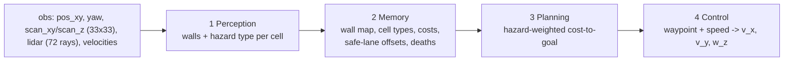

# Challenge 7.5: G1 Hazard Maze — development notes

This document describes what was developed in **`g1_hazard_lab`** compared with the Week 7 workspace it started
from, **`simulation-for-humanoid/Week07_Curriculum_Maze/g1_maze_lab`** (called *the original* below). It covers
the methods, algorithms and code of the two parts the challenge lets a team submit:

| Part | File(s) | Role |
|---|---|---|
| Walking policy | `policy.pt` ← `logs/rsl_rl/g1_hazard_pro/2026-10-31_17-46-45_skill_curr1500/model_8497.pt` | "legs": turns `(v_x, v_y, w_z)` commands into joint targets |
| Pilot | [`pilot.py`](pilot.py) | "brain": reads the sensors, maps the maze, plans the route, sends velocity commands |

---

## 1. Summary of results

All runs use `scripts/challenge.py` with the official rules: spike beds are deadly; a fall, any torso/pelvis/elbow/palm
contact, or < 0.25 m of movement in 10 s sends the robot back to the start while the clock keeps running.

| Run (`PILOT_MODE=short`) | Original-style setup ¹ | Final setup ² |
|---|---|---|
| Level 7, seed 2026 | 111.7 s, 2 falls | **62.1 s, 0 falls** |
| Level 7, seed 1 | 68.2 s, 0 | **64.4 s, 0** |
| Level 7, seed 2 | 104.5 s, 0 | **107.4 s, 0** |
| Level 7, seed 3 | 92.4 s, 0 | **90.0 s, 0** |
| Level 7, seed 4, random ends | 114.0 s, 1 | **55.6 s, 0** |
| Level 9, seed 1 | 129.6 s, 0 | **121.7 s, 0** |
| Level 9, seed 2 | did not finish (6 falls, 3 slalom spike hits) | **101.4 s, 0** |
| Level 9, seed 3 | 173.2 s, 1 | **108.3 s, 0** |
| Level 9, seed 5, random ends | 189.1 s, 1 ³ | **127.8 s, 0** |

¹ Level 7 seed 2026: `auto` mode with the earlier `model_6799.pt` policy. Other rows: the new policy `model_8497.pt`
with the pilot *before* the slalom, speed and curved-turn work (Section 4.5–4.7).
² `model_8497.pt` + the final `pilot.py`.
³ This run already had the first slalom change (sideways strafe), but not the knee offset.

For reference, the challenge slides report that the course's `DefaultPilot` did not finish level 7 seed 7
(51 falls, 49 of them spike hits), and that the instructor's own solution did not finish level 9 or the sample final mazes.

The pilot now runs in about **0.6× real time** (a 100 s run takes about 60 s of wall clock). Before the speed-up it
ran at 1.4–2.4×, which risked the runner's **18-minute wall-clock limit** on a 600 s final run.

---

## 2. What changed, file by file

| File | Original (`g1_maze_lab`) | Now (`g1_hazard_lab`) |
|---|---|---|
| `pilot.py` | 724 lines. Hazard-aware pilot, first version (4 layers, see Section 4). | 961 lines. Reworked perception, memory, planning triggers, slalom, curved turns and CPU execution. |
| `src/g1_maze_lab/tasks/curriculum/mdp/curriculums.py` | 3 curriculum terms (reward-weight ramp, adaptive push, command range). | + `terrain_levels_skill`, a terrain curriculum that works with turning commands. |
| `src/g1_maze_lab/tasks/curriculum/mdp/__init__.pyi` | Exports the 3 terms. | Also exports `terrain_levels_skill`. |
| `src/g1_maze_lab/tasks/hazard_starter/env_cfg.py` | `G1-Hazard-Starter` / `G1-Hazard-Pro`: maze-shaped trenches, ramps, boxes + rough ground. Uses Isaac Lab's `terrain_levels_vel`. | Same terrain; the terrain curriculum is replaced by `terrain_levels_skill`. |
| `scripts/challenge.py` | — | Loads `./pilot.py` by default when testing locally; shows the scanner rays in the viewer. Rules unchanged. |
| `tests/test_pilot_review.py` | — | New: 8 regression tests for the pilot. |
| `tests/test_terrain_curriculum.py` | — | New: 4 tests for the curriculum term. |
| `pyproject.toml` | — | Only the relative path to `IsaacLab` (different folder depth). |

The maze generator (`terrains/hazard_maze.py`), the challenge rules, the sensors and the policy's network shape are
**unchanged**, as the challenge requires.

---

## 3. Walking policy: fixing the terrain curriculum

### 3.1 Problem

`G1-Hazard-Pro` trains on four kinds of 8 m × 8 m tiles across 10 difficulty rows. For a tile in row *r*, Isaac Lab
sets the difficulty to about `(r + U(0,1)) / 10`. On the ramp tiles the height grows with difficulty from 0.08 m to 0.30 m:

```
ramp height = 0.08 + difficulty * (0.30 - 0.08)
```

So the maze's **steep ramps (0.24–0.30 m) only exist in rows 7–9**.

The TensorBoard log of the original training run (`g1_hazard_pro/2026-10-31_14-25-28`) showed:

| Iteration | 5600 | 5900 | 6200 | 6500 | 6799 |
|---|---|---|---|---|---|
| `Curriculum/terrain_levels` (average row) | 2.46 | 0.41 | 0.41 | 0.73 | **0.92** |
| Velocity-tracking reward | — | 0.76 | 0.81 | 0.78 | 0.76 |

The robots walked well (about 95% of episodes timed out normally) but stayed in rows 0–1, where ramps are only
0.08–0.13 m. In a real run the policy stalled at the foot of the 0.248 m ramp.

### 3.2 Root cause

Isaac Lab's `terrain_levels_vel` judges a robot by **straight-line distance** from where it spawned:

```
move_up   = distance > tile_size / 2                          (> 4 m)
move_down = distance < |command_xy| * episode_length * 0.5    (e.g. 0.85 m/s * 20 s * 0.5 = 8.5 m)
```

This assumes the robot walks straight, which is true with Isaac Lab's default `heading_command = True`. The hazard
task sets `heading_command = False`, because the pilot sends raw `(v_x, v_y, w_z)` commands. Each robot then gets a
random yaw rate of up to ±1.2 rad/s and **walks in a circle** of radius `v / w`. Its distance from the spawn never
exceeds `2v / w`, about 2.7 m at `v = 0.8`, `w = 0.6`. So it almost never moves up and almost always moves down,
however well it walks. The challenge slides (pages 8 and 19) describe the same failure.

### 3.3 Method: `terrain_levels_skill`

Code: [`curriculums.py:165`](src/g1_maze_lab/tasks/curriculum/mdp/curriculums.py:165), wired up in
[`hazard_starter/env_cfg.py:245`](src/g1_maze_lab/tasks/hazard_starter/env_cfg.py:245).

Instead of distance, the term judges **how well the robot walked** over the episode. It runs when environments reset,
before the episode reward sums are cleared:

```
track     = episode_sum(track_lin_vel_xy_exp) / episode_length_s / weight     # 0..1, mean tracking quality
fell      = base_contact OR physics_blowup terminated this episode
timed_out = episode reached its time limit
distance  = |root_xy - spawn_xy|

move_up   = timed_out AND NOT fell AND track > 0.75 AND distance > 2.0 m
move_down = (fell OR track < 0.50) AND NOT move_up
```

* `distance > 2.0 m` makes sure the robot actually left the flat spawn platform and met the hazard ring. On the ramp
  tile the ring starts at 1.0 m and its crest is at 2.0 m; on the trench tile the platform half-width is 1.1 m.
* `track < 0.5` demotes a robot that stood stuck at the foot of a ramp or trench without falling.
* Robots in between keep their row.

Unlike `heading_command = True` (the instructor's fix), this keeps training on the same direct
`(v_x, v_y, w_z)` commands the pilot sends, including sideways (`v_y` ±0.35 m/s) and backward (`v_x` down to −0.25 m/s)
commands.

### 3.4 Training and result

```bash
uv run isaaclab train --rl_library rsl_rl --task G1-Hazard-Pro --num_envs 1024 --checkpoint logs/rsl_rl/g1_hazard_pro/2026-10-31_17-40-07_curriculum_smoke/model_6998.pt agent.max_iterations=1500 agent.run_name=skill_curr1500
```

(`model_6998.pt` came from a 200-iteration check run started from `model_6799.pt`.)

| Iteration | 7185 | 7373 | 7560 | 7748 | 8123 | 8497 |
|---|---|---|---|---|---|---|
| Average terrain row | 2.2 | 3.9 | 5.2 | 5.9 | 6.2 | **6.4** |
| Velocity-tracking reward | 0.78 | 0.75 | 0.75 | 0.75 | 0.75 | 0.80 |
| Falls per episode | 4% | 5% | 6% | 7% | 6% | 5% |

The average levels off near 6.4 because Isaac Lab sends robots that clear the top row back to a random row. The
command curriculum also widened forward speed to 1.35 m/s, and pushes reached 0.8 m/s. The resulting `model_8497.pt`
crosses both 0.25–0.26 m ramps, the trench and the spike beds of level 7 seed 2026 with no falls.

---

## 4. Pilot (`pilot.py`)

### 4.1 Architecture

Both versions use the same four layers on top of the course's `MazeAutopilot` (grid indexing and lidar helpers):



What is new is inside each layer, plus a performance layer. In the tables below, **Original** means
`g1_maze_lab/pilot.py`.

### 4.2 Layer 1: perception

**Cell classification** (`_classify_cell_from_scan`). For each visible cell, scan points are converted to corridor
coordinates: `u` along the corridor, `v` across it. Rules, applied in order:

1. **Trench:** at least 3 points with `z < −0.15 m`.
2. **Elevated points** (`0.11 < z < 0.42`) split into four quadrants (`u` sign × `v` sign):
   * **Slalom:** each `u` half is elevated on one side only, the sides differ, and the centre band `|u| < 0.22` is
     clear. Safe lanes: `v = ∓0.48 m` per half.
   * **Ramp:** both sides elevated in the same `u` slice. Steep if height > 0.205 m, otherwise low.
   * **Single-lane spike bed:** elevated on one side only. Safe lane: `v = 0.48 m` on the other side.
3. **Rough** (at least 4 points at 2.5–9.5 cm), **ice** (flat with median `z` 0.6–1.6 cm), otherwise **plain**.

| Topic | Original | Now |
|---|---|---|
| Ramp height from a partial view | 90th-percentile height of what is visible. From the previous cell only the near slope shows, so a 0.24 m ramp read as about 0.19 m and was saved as a **low** ramp (cost 1.45 instead of 22). | If the flat top (`\|u\| < 0.2`) is not visible, `_ramp_height_from_slope` ([`pilot.py:324`](pilot.py:324)) fits a line `z = a + b·\|u\|` to the slope points (`0.30 < \|u\| < 0.95`) and extrapolates it to the top edge `\|u\| = 0.25`. |
| Downgrading | A later partial view could turn a steep ramp into a low one. | A steep ramp is never downgraded unless the top is in view. |
| Walls | The current cell's 4 sides were **overwritten every step** from the height scan, so walls behind the robot (out of scan range) were forgotten. Neighbour cells could only gain walls. | `_scan_walls_with_coverage` ([`pilot.py:346`](pilot.py:346)) also reports **coverage**: at least 8 scan rays inside the 0.3 m × 1.2 m wall box. `_update_cell_walls` **latches** a confirmed wall permanently and marks a side open only when it was fully covered. |
| Lidar | Angular cone check (`walls_from_lidar`) only near the cell centre. | Lidar hits are also converted to XY points (`pos + d·(cos θ, sin θ)`), and at least 2 points inside a wall box confirm a wall up to 2 cells away. The lidar flies at chest height above every floor hazard, so it only ever hits walls. |

Checked offline at five viewing distances: low ramps (0.14–0.18 m) still read as low, and steep ramps (0.24–0.30 m) read
as steep from the previous cell's centre onward.

### 4.3 Layer 2: memory and failure attribution

Both versions keep the wall map, cell types and costs across resets, and add **+50 cost** to the cell where a reset
happened (`50 × deaths` is part of the cell cost).

| Topic | Original | Now |
|---|---|---|
| Anti-stuck penalty | +15 was added straight into `cell_cost` and **erased on the next frame**, because re-classifying the cell recomputes `cost = base + 50·deaths`. | Kept in a separate `cell_penalty` map: `cost = base + 50·deaths + penalty`. |

### 4.4 Layer 3: planning

**Hazard-weighted cost-to-goal** (`weighted_flood_fill`, [`pilot.py:476`](pilot.py:476)). This is Bellman-Ford over the
grid. Entering a cell costs that cell's cost, confirmed walls block edges, and unknown walls are treated as open
(optimistic exploration):

```
dist[goal] = 0
repeat until no change:  dist[c] = min over open neighbours n of ( dist[n] + cost[n] )
```

`choose_direction` picks the open side with the lowest `dist[n] + cost[n] + turn_penalty`, where the penalty is 0.08
for a turn and 0.25 for turning back, so ties go straight on.

Two cost tables (`PILOT_MODE`):

| Cell | `auto` | `short` |
|---|---|---|
| plain / unknown | 1.0 / 1.05 | 1.0 / 1.05 |
| ice / rough / low ramp | 1.2 / 1.35 / 1.45 | 1.15 / 1.2 / 1.3 |
| spike lane | 1.75 | 1.5 |
| slalom / trench / steep ramp | 16 / 18 / 22 | 3.5 / 2.5 / 3.0 |

`auto` avoids the short route's hard hazards. `short` takes them; it is the right mode now that the policy can climb
the steep ramps.

| Topic | Original | Now |
|---|---|---|
| Replanning on hazards | `hazard_surprise` was true on **every step** while walking toward a slalom, trench or steep ramp the planner had already chosen, so the full Bellman-Ford ran 50 times a second. | The hazard type of the target is stored at decision time (`decided_tgt_type`). The planner reruns only when it changes ([`pilot.py:760`](pilot.py:760)). |
| Repeated computation | Recomputed on every call, including twice every 2 steps for the viewer's debug panel. | Cached until the wall map or the costs change (`_ff_cache`). |

### 4.5 Layer 4: local control

The controller turns a **waypoint** and a **speed limit** into commands. Normally it turns toward the waypoint
(`w_z = 1.6 · yaw_err`, capped at 1.1 rad/s, 0.65 on ice), scales `v_x` by `cos²(yaw_err)`, adds a small sideways
correction `v_y`, and limits acceleration (1.2 m/s², 0.6 on ice).

**Spike lane** (unchanged idea): hold `v = ±0.48 m` from the centreline, 0.65 m ahead, at 0.48 m/s. The lane is
pre-aligned from the previous cell.

**Slalom** (rewritten). Geometry: bed 1 at `u ∈ [−0.9, −0.3]` on one side, bed 2 at `u ∈ [+0.3, +0.9]` on the other,
a 0.6 m gap between them. Here `u_rel` is the position along the travel direction.

| Stage | Original | Now |
|---|---|---|
| 1. Approach in the entry lane | Until `u_rel = −0.22`, aiming at `u = −0.10`. | Until `u_rel = SLALOM_HOLD_U − 0.06`, aiming at `SLALOM_HOLD_U = −0.10`. Slows to 0.28 m/s within 0.55 m. |
| 2. Cross the gap | Aim at the exit lane with **forward motion still on** (≥ 0.25 m/s, turning toward the lane). Past `u_rel = 0.25` it jumped to stage 3 even if not yet in the lane. | **Sideways strafe** (`self.strafe`): face straight down the corridor (`w_z` holds the corridor heading), `v_y = 1.2 · lateral_error` capped at ±0.35 m/s (the trained range), `v_x` only holds the pelvis at `SLALOM_HOLD_U` (−0.15 to +0.12 m/s). Never advances until the robot is in the exit lane. |
| 3. Exit | Walk out in the exit lane. | Same, entered only once `\|v − v_exit\| ≤ 0.15 m`. |
| Cone sidestep | Generic sidestep active, and it pushed the wrong way (toward the second bed's side). | Off inside slalom cells; the stage logic handles the beds. |

**Why `SLALOM_HOLD_U = −0.10`.** A debug trace logged every robot link inside the bed rectangles. While strafing, the
policy crouches, and its **knees sit 0.21–0.32 m ahead of the pelvis at about 0.31 m height**. That is below the
0.37 m spike-hit height, so a pelvis held at the gap centre puts the knees into bed 2 (which starts at `u = +0.30`). No
link reached back toward bed 1. Holding the pelvis 0.10 m behind the centre keeps the knees (+0.22) and heels inside
the gap.

**Other control fixes**

| Topic | Original | Now |
|---|---|---|
| Arrival at a target cell | Only within 0.22 m (near hazards) or 0.52 m of its centre. After a slip past the centre, the waypoint stayed behind the robot and it turned around. | Also arrives once past the centre along the travel direction (`past_centre`). |
| Unstuck reflex (3.5 s without 0.28 m of progress) | Backs up at −0.25 m/s, strafing and turning ±, **alternating sides blindly**, so one attempt in two strafed into a spike bed. | `_side_away_from_cones` ([`pilot.py:689`](pilot.py:689)) picks the side away from cone-height points within 1.2 m; it alternates only when no cones are near. |

### 4.6 Curved turns (new)

The original picked the next cell 0.52 m before the corner cell's centre, then aimed at the next cell's centre, about
75° away. Any heading error above 0.7 rad drops the speed to 0.25 m/s, so every corner meant braking, turning and
speeding up again. The challenge slides (page 20) suggest curves for about 20% speed.

Method:

1. **Decide earlier** ([`pilot.py:750`](pilot.py:750)). In plain cells, pick the next cell once the robot is within
   `TURN_DECIDE_DIST = 0.9 m` of the centre and within 0.45 m of the centreline, but **only when the three sides ahead
   are already known**. Unknown sides are never chosen as open, so deciding before seeing them would bias the choice.
   This doesn't apply near spikes, trenches or steep ramps, or on ice.
2. **Pure pursuit on the cell path** (`_pursuit_point`, [`pilot.py:653`](pilot.py:653)). The path is the polyline
   *previous centre → corner centre → next centre*. The robot finds its closest point on it (arc length `s`) and aims
   at the point at `s + PURSUIT_LOOKAHEAD` (0.7 m). Near the corner the lookahead point moves onto the second segment,
   so the robot walks a smooth arc that cuts the corner by a few tenths of a metre, keeping well clear of the inner
   wall corner.
3. **Speed from curvature.** The curvature to the lookahead point is `κ = 2·|sin(yaw_err)| / d`; the speed is
   `v = min(v_max, √(a_lat / κ))` with `a_lat = LAT_ACC_MAX = 0.6 m/s²` (half on ice), floored at 0.25 m/s.
4. **No sideways correction in curves.** The lookahead point sits inside the corner, and `v_y` toward it would crab the
   robot toward the inner wall.
5. **Exceptions.** U-turns, the start, hazard waypoints (spike lanes, slalom, pre-alignment) and **ice corners** keep
   the old behaviour. Ice was excluded after a benchmark run fell on an ice corner (level 7 seed 2, cell (4, 5)).

### 4.7 Performance (new)

`act()` was timed with synthetic observations on the same machine:

| Version | Median per step | 90th percentile |
|---|---|---|
| Before the speed-up, tensors on CUDA (as in the original) | 27.4 ms | 30.4 ms |
| Before the speed-up, same code on CPU | 7.6 ms | 8.7 ms |
| **Final** | **1.4 ms** | 5.4 ms |

At 50 steps per second, 27 ms per step is about 14 minutes of pilot time for a 600 s final run, close to the
runner's 18-minute limit. Three changes:

1. **CPU execution** ([`pilot.py:85`](pilot.py:85)). The pilot does hundreds of tiny tensor operations and `.item()`
   reads per step, and on CUDA each read forces a GPU sync. The observations are copied to the CPU once per step, all
   pilot state lives on the CPU, and the command is copied back to the simulator's device.
2. **Sensing decimation** ([`pilot.py:715`](pilot.py:715)). The full wall and hazard scan runs every 3rd step (the
   robot moves about 3 cm in between), and also immediately on entering a new cell or when a decision is needed.
   Otherwise the stored walls are used. Spike repulsion and slalom logic still read the live scan every step.
3. **Route cache** (Section 4.4).

---

## 5. Testing

### 5.1 Unit tests (no simulator)

```bash
uv run pytest tests
```

60 tests pass. The new ones are:

| Test | Checks |
|---|---|
| `test_stuck_penalty_still_changes_the_plan` | The +15 stuck penalty survives re-classification and changes the route. |
| `test_steep_ramp_seen_from_previous_cell_is_not_low` | Slope extrapolation reads a 0.24 m ramp as steep. |
| `test_steep_ramp_is_not_downgraded_by_a_later_partial_view` | No STEEP → LOW downgrade. |
| `test_slalom_does_not_advance_into_second_bed_before_crossing` | The slalom waypoint never moves into bed 2 before the lane change. |
| `test_unstuck_reflex_never_strafes_toward_spike_bed` | The unstuck reflex strafes away from the bed. |
| `test_planner_does_not_rerun_every_step_toward_a_chosen_hazard` | At most one replan for a hazard that is already known. |
| `test_robot_past_target_centre_gets_a_new_target` | Re-targets after overshooting a centre. |
| `test_corner_is_decided_early_and_walked_as_a_curve` | Early decision and a lookahead point around the corner. |
| `test_terrain_curriculum.py` (4 tests) | Circling but walking well → up; fall → down; stuck at a ramp → down; never left the platform → stays. |

### 5.2 Simulator benchmark

```bash
PILOT_MODE=short uv run python scripts/challenge.py --level 9 --seed 3 --pilot pilot.py --policy logs/rsl_rl/g1_hazard_pro/2026-10-31_17-46-45_skill_curr1500/model_8497.pt
```

Eight mazes: level 7 seeds 1–3, level 7 seed 4 with `--random-ends`, level 9 seeds 1–3, and level 9 seed 5 with
`--random-ends` (seed 4 is skipped because the maze generator can't build a level 9 random-ends maze for it). Results
are in Section 1.

### 5.3 Debugging method

Falls were investigated with a debug-only wrapper around `Pilot`, kept outside the project and never submitted. It
logged position, target, cell types, safe-lane offsets and commands every step, plus robot link positions near spike
beds, combined with `CHALLENGE_SHOW_MAZE=1` (prints the real maze) and viewer snapshots (`MAZE_SNAP_AT`). This found:

* **Wide U-turns** at speed swinging the robot toward a wall (the likely cause of early wall crashes).
* **Partial ramp views** read as spike beds.
* A **reset in the start cell** penalising the long route's first cell.
* The **slalom knee geometry** (Section 4.5).

---

## 6. Known limitations and open items

| Item | Status |
|---|---|
| `PILOT_MODE` defaults to `auto` | The runner sets no environment variables. **Change the default to `short` before uploading**, otherwise the pilot avoids the steep ramps the policy can now climb. |
| Wide U-turns near walls | Not changed. Turning back at speed still uses `min_speed` 0.25 m/s, which swings the robot about 0.7 m sideways. Turning on the spot would be safer (elbows and palms count as a crash). |
| Wall clearance | The pilot has no body-width model; it relies on lane offsets and curve geometry. |
| Death attribution | Only one cell is penalised. A spike hit while the pelvis is still in the cell before the bed penalises the plain cell. A reset in the start cell penalises the target, which can be the other route's entrance. |
| Partial ramp seen as spikes | A ramp seen at the scan's edge on one side only can briefly be classified as a spike bed until more of it is visible. |
| False STUCK at the 10 s check | The challenge compares positions 10 s apart. Being back near the same spot by chance (for example right after a spike reset) counts as stuck. |
| Permanent wall latch | A false wall is never removed. |
| Final level | The final adds a slalom on the long route too, and starts and goals at least 10 cells apart. Slalom handling is the same on either route, but no final-size maze could be run locally (its task folder is released on challenge day). |

---

## 7. How to reproduce

```bash
uv run pytest tests
```

```bash
uv run isaaclab train --rl_library rsl_rl --task G1-Hazard-Pro --num_envs 1024 --checkpoint logs/rsl_rl/g1_hazard_pro/2026-10-31_17-40-07_curriculum_smoke/model_6998.pt agent.max_iterations=1500
```

```bash
PILOT_MODE=short uv run python scripts/challenge.py --level 7 --seed 2026 --pilot pilot.py --policy logs/rsl_rl/g1_hazard_pro/2026-10-31_17-46-45_skill_curr1500/model_8497.pt --viz newton
```

On Windows, add `PYTHONIOENCODING=utf-8` when redirecting output to a file; otherwise Isaac Lab's loading screen
crashes on a non-ASCII character.

Submission: upload `model_8497.pt` as `policy.pt`, plus `pilot.py` (with the `short` default).
